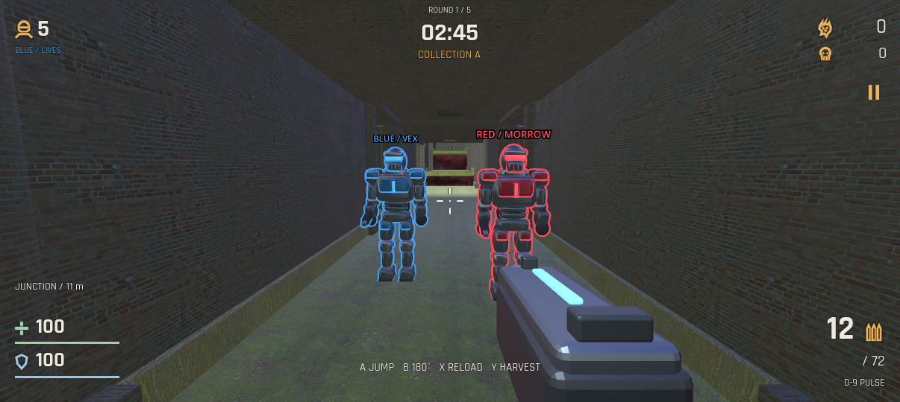
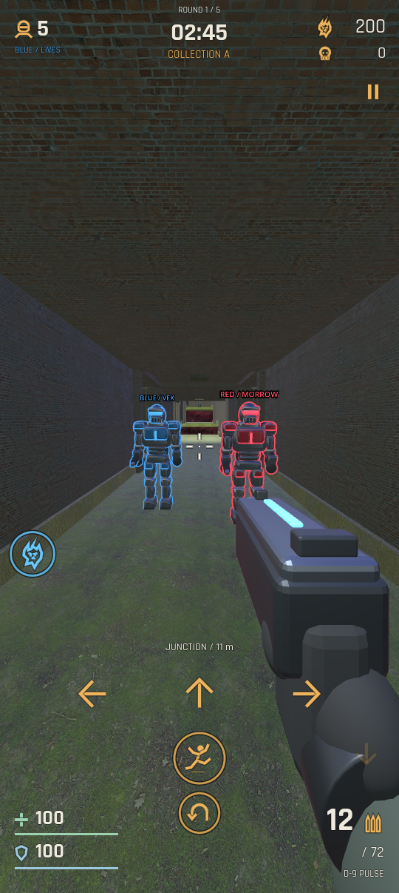

# Dominion '99 (Lite)

A dark sci-fi auto-runner FPS with portrait, landscape, and gamepad support for Android: aim, choose routes, harvest essence, and hunt rivals.

**[Download APK — v0.6.0](https://github.com/Tweeksterr91/dominion-99-lite/releases/download/v0.6.0/dominion-99-lite.apk)** · **[Releases](https://github.com/Tweeksterr91/dominion-99-lite/releases)**

Development prototype for the OnePlus 12R, built with Godot 4.6.3. Fixed **60 FPS cap**, automatic portrait/landscape rotation. Actual phone performance and Wi-Fi behavior still need device testing.





## Install and update

Open the latest release while signed into the GitHub account with access to this private repository. Download `dominion-99-lite.apk`, open it from Downloads, and choose Install or Update. Allow installation from the app opening the APK if Android asks. The package and development signing key are preserved between versions; Godot is not needed to play. Keep the existing installation to retain settings and campaign unlocks.

## Match flow

A match has **five rounds**. Everyone starts **each round with five lives**.

1. **Collection — 2:45.** Players cannot damage each other. Kill smaller PvE minions; each drops three hovering blue essence clusters above its corpse. Tap the blue essence icon on the left to extend a hand and draw nearby visible essence into it. Souls are credited on arrival. A closer collector can steal a cluster already being pulled. Hold the crosshair on essence for 0.55 seconds to shoot and deny it; nobody receives those souls. Pulling suppresses your own denial shots.
2. **Shop — up to 1:00.** Spend souls on three weapon profiles, damage/health/shield/reload upgrades, health restoration, or reserve ammo. Ready up when done; the shop closes early if everyone is ready. Movement and combat stop during shopping.
3. **Shared roll — 6 seconds.** Every player receives one small random passive benefit. Everyone sees all rolls before hunting begins. Benefits include +2% damage, +5 shield, 3% faster reload, +1 m pull reach, or slightly earlier shield recovery. Gifts stack across rounds.
4. **Hunting — 2:45.** Fight the opposing team; friendly fire is disabled. Death consumes one life and respawns after three seconds while lives remain. An eliminated player spectates until the next round. Eliminating a team ends hunting early.

Round standings prioritize remaining team lives, then frags, then collected essence. The team with more round wins wins the match; equal round wins are a draw. Souls, owned weapons, upgrades, gifts, and match frags persist between rounds. Health, shield, lives, and starting ammunition reset for the next round.

## Controls and HUD

- Rotate the phone at any point. The game reflows between portrait and landscape without restarting the match. Both landscape directions are supported, with screen-edge safe-area margins and an orientation-aware field of view. In Options, SCREEN cycles Auto → Portrait → Landscape. Auto follows the phone's rotation setting; the Portrait/Landscape choices lock that view and still allow either direction.
- The character runs automatically. Drag the open play area to aim (default sensitivity is now 180% of the earlier speed); a visible enemy under the crosshair is shot automatically. There is no running, strafing, or fire button.
- Amber left/ahead/right arrows queue the next junction decision. The jumping-person icon sits below the ahead arrow. Tap once to jump, twice for a double jump; the circular U-turn button below jump reverses your run direction by 180° immediately. DOWN queues an available descending route. Route hints identify elevated paths. Missing a landing returns the runner to that hallway's start and costs 25 shield/health.
- **An empty magazine waits for a tap anywhere to start reloading.** The crosshair ring shows reload progress. A second tap in the amber segment completes it early. An early/late tap uses the bonus attempt but allows normal completion. Dragging an existing aim touch does not count as a new tap. There is no separate reload button.
- Lives sit at the upper left; souls and frags at the upper right. The phase timer sits at the top center. Health and regenerating shield hug the bottom left; ammo and reserve hug the bottom right. No dark HUD panels.
- Green pickups restore health; amber pickups supply ammunition. Shield recovers at 20/second after four seconds without damage, modified by gifts.
- Pause freezes offline matches. **LAN matches continue behind the pause menu.** Keep the host app in the foreground.

Desktop testing: mouse aim, A/D/W/S (or arrows) for routes, Space to jump/double jump, Q to reverse 180°, E to pull essence, R or mouse tap to reload, Esc to pause.

## Backbone and other Android controllers

The game accepts Godot's standard Android/SDL gamepad mapping over **USB-C or Bluetooth**, covering Backbone Android, Xbox-style, PlayStation-style, and other mapped Android controllers. It detects connection/disconnection and switches between touch and controller input. These paths have been tested with synthetic standard gamepad events; **physical Backbone and other hardware still need device testing**. Vendor firmware, unusual HID mappings, and OS-reserved buttons can vary. A controller companion app is not required by the game.

| Controller input | Action |
| --- | --- |
| Left stick / D-pad | Queue left, ahead, right, or a descending route |
| Right stick | Aim; shooting remains automatic over a valid enemy |
| A / south face button, or RB | Jump / double jump |
| B / east face button, or LT | Reverse 180° |
| X / west face button, or RT | Start reload when empty; release and tap again in amber for active reload |
| Y / north face button, or LB | Harvest souls |
| Start / Menu | Pause / resume |
| View / Select | Controller guide |

Menus use the left stick or D-pad, south face button to select, and east face button to go back. The shop and menus are navigable by controller; entering a LAN IP still uses the phone's keyboard. Recognized PlayStation and Nintendo names receive matching face-button labels; other pads use A/B/X/Y labels by position.

**Options → Controller Settings** provides independent stick aim sensitivity (50–300%), a radial deadzone (10–35%, default 18%), stick swapping, saved primary button remapping, and restore defaults. Small stick inputs get a curved response for fine aiming. Shoulder shortcuts apply unless assigned another action. Trigger actions use press/release thresholds, so holding RT does not consume the reload bonus attempt.

Touch controls hide when a controller is used and return on touch. The controller HUD retains health, shield, ammo, timer, crosshair, route hints, and button prompts. Disconnecting pauses offline play; LAN stays live and offers touch fallback. Reconnect and press a button or move a stick to resume controller input. Orientation and controller changes do not reset lives, equipment, or round progress.

## Menus and campaign

The Godot splash image is disabled. Android may still briefly show the app icon during native startup. The title screen runs a real AI-controlled gameplay demonstration behind the logo. Tap to enter the main menu: **Single Player Campaign**, **Multiplayer**, **Options**, **Quit Game**, and art credits.

The initial campaign is a sequence of bot matches across five biome maps, unlocked by winning: Verdant Ruins, Blue Catacombs, Ember Vault, Rootbound Forest, and Dune Coast. It is a match-based campaign foundation, without story cinematics. Options persist aiming sensitivity from 50%–300% in 10% steps, with a 180% reset, invert aim, separate effects/music/ambience volumes, camera motion, and the screen-orientation preference. Weapon profiles currently share the modeled sidearm with size adjustments.

## Players, minions and audio

Players now use an original, rigged **Sentinel** armored humanoid, larger than every minion type. Blue team (team 0) has blue armor accents and a blue silhouette outline; red team (team 1) has red accents and a red outline. Outlines respect walls. Running, idle, and jump animations are original to this player model. The smaller creatures retain their separate Sinbad-derived design.

| Minion | Health | Behavior | Souls dropped |
| --- | --- | --- | --- |
| Scavenger | 65 | Standard ranged minion | 15 blue |
| Stalker | 40 | Faster, lighter, violet-toned | 15 blue |
| Brute | 110 | Slower, tougher, heavier hits | 20 blue |
| Gilded Revenant | 80 | Rare gold-crowned treasure minion; flees instead of attacking | 90 gold |

One treasure minion appears at a seeded random time between 55 and 125 seconds into each collection phase. Its six gold clusters can be harvested or stolen by either team. **Gold souls cannot be destroyed**, never trigger denial shots or spend ammo, and persist until collection ends. Ordinary blue essence can still be shot away and expires after 25 seconds.

Each biome has its own original, unobtrusive ambient industrial/techno loop, layered with a quiet brown-noise rumble. Music and ambience have independent mute/volume controls and pause with offline play. The audio is synthesized from scratch; no third-party tracks or samples are used. Reproduce it with `art_sources/build_soundscapes.py` (Python, NumPy/SciPy and ffmpeg). `art_sources/build_sentinel.py` generates the original player model and animations in Blender.

## Local Wi-Fi / direct-IP multiplayer

**1v1, 2v2, 3v3, and 4v4** use a phone as the authoritative ENet host. Empty slots are filled with bots. At least two human phones are required to launch a LAN match; Practice With Bots works offline in every format.

1. Install the same game version on all phones and connect to the same Wi-Fi or phone hotspot.
2. Host: Multiplayer → team format → Host Room. The lobby displays the host's local IP address and UDP port **27799**.
3. Guests: Multiplayer → Join Room. Enter the host's numeric Wi-Fi IP address, connect, and tap Ready.
4. Host taps Start Match after guests are ready. The next human joins the opposing team first.

Wi-Fi networks with client isolation can block phone-to-phone traffic; try a private router or hotspot. This version has no Internet matchmaking, cloud server, account login, or NAT traversal. A disconnected guest is replaced by a bot; if the host leaves, guests return to the menu. Rejoining an ongoing match is not supported yet.

The host validates movement/actions, hits, damage, purchases, essence ownership, and rolls. Clients predict local movement and receive compressed, bounded UDP snapshot fragments. Two real local game processes have been tested through collection, shopping, shared rolls, hunting, purchases, and disconnect takeover. Testing on two physical Android phones remains necessary.

## Source and assets

Import `project.godot` in the official Godot Editor for Android to edit on your phone. The world is built at runtime. The Compatibility renderer uses scanned 1K materials, mipmaps, 2x anti-aliasing, and one short-range directional shadow map. This is an evolving art foundation, with an animated imported creature and original modeled weapon/essence hand.

- `scripts/souls_arena.gd`: active game, menus, combat, AI, local prediction and host simulation.
- `scripts/match_rules.gd`: five-round rules, economy, team protection, rolls.
- `scripts/lan_session.gd`: LAN rooms, readiness, validated actions and snapshot transport.
- `scripts/controller_input.gd`: standardized gamepads, analog look, contextual actions, remapping, and hot-plug handling.
- `scripts/minion_types.gd`, `map_soundscape.gd`: enemy variants and map audio.
- `scripts/rail_motion.gd`: shared host/client autorun and real jump physics.
- `scripts/arena_hud.gd`, `match_reticle.gd`, `ui_glyph.gd`: portrait UI and original vector icons.
- `scripts/essence_cloud.gd`: shared essence, stealing, denial, batched particles.
- `scripts/corridor_map.gd`, `visual_assets.gd`: five connected layouts, art and animation helpers.
- `scripts/runner.gd`, `main.gd`: earlier prototype and reusable foundation.
- `art_sources/`: editable Blender generation and conversion scripts.

See [asset credits and licenses](ASSET_CREDITS.md). Original code, generated scenery, Sentinel player/animations, sidearm, hand, icons, and synthesized audio use MIT. The adapted Sinbad creature and its textures use CC BY-SA 3.0; scans and lighting panorama are CC0. Rajdhani uses SIL OFL. Screenshots/video containing Sinbad are CC BY-SA 3.0 with attribution in ASSET_CREDITS.md.

## Validation and releases

```sh
godot --headless --path . --script tests/controller_orientation.gd
godot --headless --path . --script tests/upgrade_features.gd
godot --headless --path . --script tests/match_rules_test.gd
godot --headless --path . --script tests/souls_game_test.gd
godot --headless --path . --script tests/ui_navigation.gd --quit-after 120
godot --headless --path . --script tests/rail_traversal.gd
```

For the two-process LAN integration test, start `tests/lan_game_peer.gd -- host`, then `tests/lan_game_peer.gd -- client` in separate Godot processes on the same machine (UDP 27809). Both must report PASS. The host uses landscape and the guest uses portrait; a simulated controller reversal travels through the actual action transport. The test advances timers to exercise all phases quickly. Legacy tests remain for the shared arena and older runner.

Every update gets a numbered GitHub Release with a new APK. Increase `version/code` and `version/name`, keep the original signing key outside the repository, and verify the APK before upload. Current builds use development signing; store distribution requires release signing.
