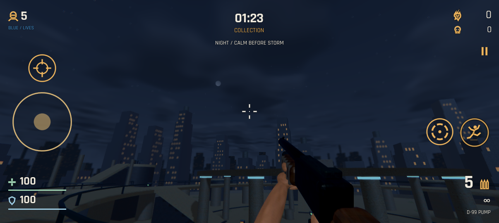
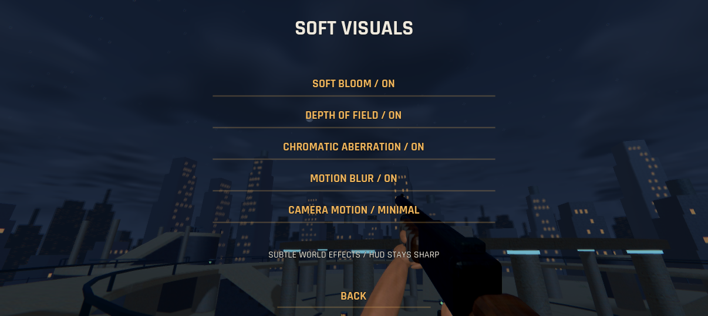
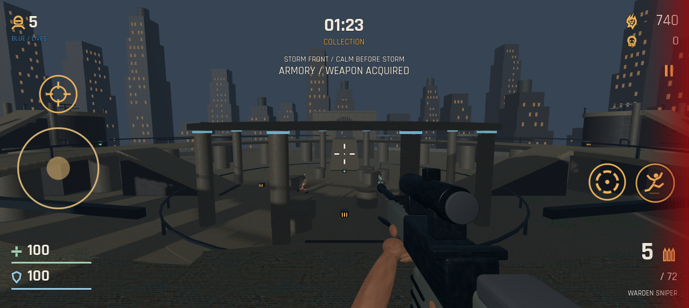
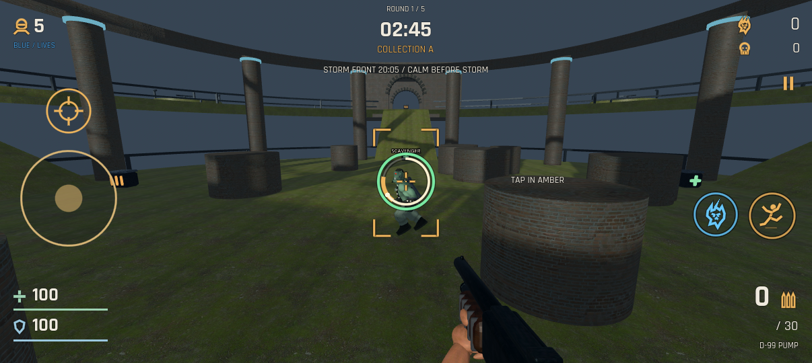
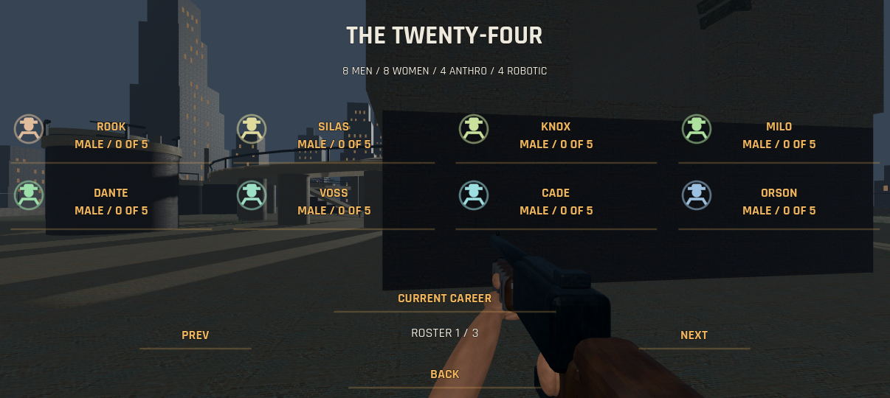
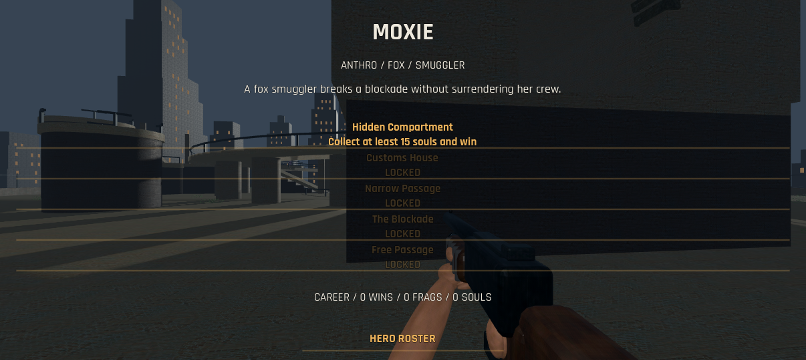
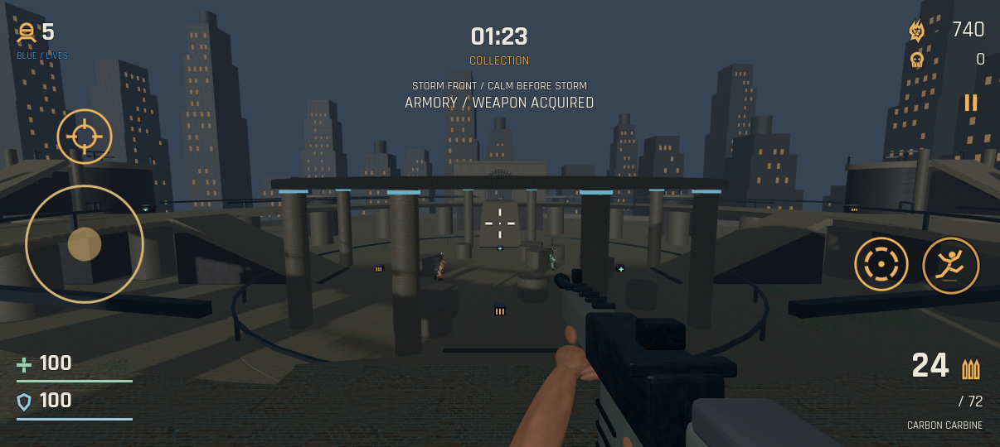
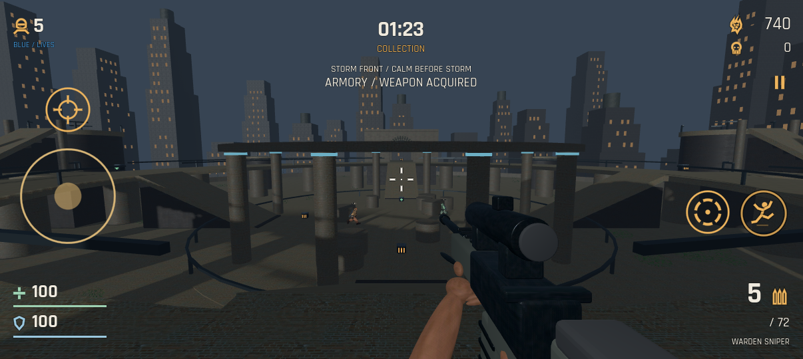
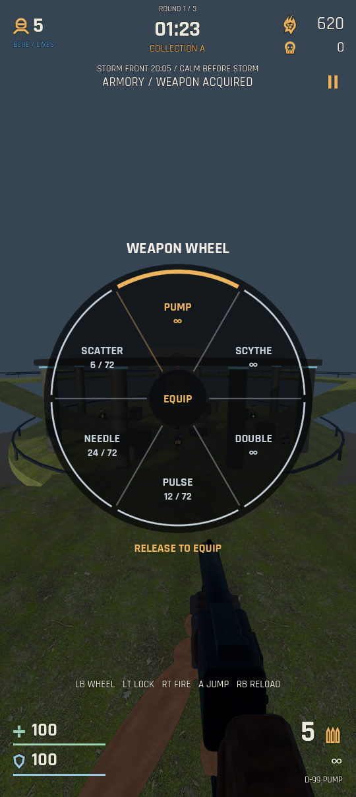
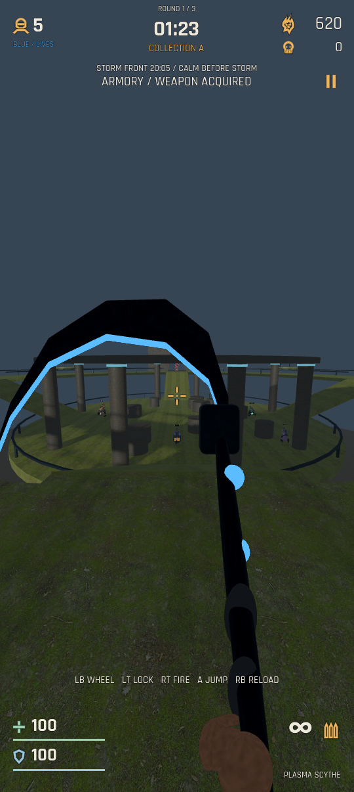

# Dominion '99 (Lite)

A dark sci-fi arena FPS set in a Neo-Prohibition New York for Android with free movement, portrait/landscape play, controller support, automatic soul rewards, and team deathmatches.

**[Download APK — v0.13.0](https://github.com/Tweeksterr91/dominion-99-lite/releases/download/v0.13.0/dominion-99-lite.apk)** · **[Releases](https://github.com/Tweeksterr91/dominion-99-lite/releases)**

Development prototype for the OnePlus 12R, built with Godot 4.6.3. Fixed **60 FPS cap**, automatic portrait/landscape rotation. Actual phone performance and Wi-Fi behavior still need device testing.






















## Install and update

Open the latest release while signed into the GitHub account with access to this private repository. Download `dominion-99-lite.apk`, open it from Downloads, and choose Install or Update. Allow installation from the app opening the APK if Android asks. The package and development signing key are preserved between versions; Godot is not needed to play. Keep the existing installation to retain settings and campaign unlocks.

## Match flow

A match is **one collection → armory → shared roll → hunting cycle**, with **five lives per fighter**. There is no round-number HUD.

1. **Collection — 1:22.5.** Players cannot damage each other. Kill smaller PvE minions: their blue soul orbs automatically fly to whoever lands the killing shot, then credit that fighter’s wallet. Rare treasure minions award gold souls the same way. Claimed orbs cannot be stolen or destroyed, and pass through walls on their way to the killer. A killer’s death does not transfer the reward. Any pending rewards settle before shopping begins. There is no harvesting hand, soul button, pull radius or manual collection input.
2. **Shop — up to 0:30.** Spend souls on additional guns, a sawed-off double-barrel upgrade, damage upgrades, tighter shotgun chokes, or reserve ammo. Already-owned weapons disappear from the armory. Acquired weapons stay owned together and can be switched during combat. Ready up when done; the shop closes early if everyone is ready. Movement and combat stop during shopping.
3. **Shared roll — 3 seconds.** Every player receives one small random passive benefit. Everyone sees all rolls before hunting begins. Benefits include +2% damage, +5 shield, 3% faster reload, +1 m lock range, or slightly earlier shield recovery. The shared gift lasts for this match.
4. **Hunting — 1:22.5.** Fight the opposing team; friendly fire is disabled. Death consumes one life and respawns after three seconds while lives remain. An eliminated player spectates for the rest of the match. Eliminating a team ends hunting early.

The winner is decided by remaining team lives, then frags, then collected essence. Equal standings produce a draw. Weapons and purchases last for this match; each new match starts fresh.

## Controls and HUD

- Rotate the phone at any point. The game reflows between portrait and landscape without restarting the match. Both landscape directions are supported, with screen-edge safe-area margins and an orientation-aware field of view. In Options, SCREEN cycles Auto → Portrait → Landscape. Auto follows the phone's rotation setting; the Portrait/Landscape choices lock that view and still allow either direction.
- **Free movement:** the left touch joystick or controller left stick moves forward/backward and strafes. Release it to stop. Drag the open play area or use the right stick to look freely through 360°. Auto-fire is enabled only while an aiming finger is held in the open touchscreen play area. Lifting that finger, switching to controller/mouse input, pausing or backgrounding stops it. Touching only movement or HUD buttons does not enable auto-fire. Controllers require RT; mouse play requires the left mouse button.
- Jump/double-jump with the circular jumping-person button (A on controllers; LB opens the weapon wheel). A circular hold-to-lock button sits above the movement stick; instant 180° turns are removed. Old junction arrows are removed. Players, rival bots and minions use real movement and collisions; bots navigate the same ramps and optional jump links.
- Each biome has a central rotunda, raised ring, side chambers, upper balconies, optional jump islands and two roofed gatehouses with stone walls and arched entrances. Ramps connect the normal routes. Inner low railings can be jumped over, with a continuous lower roof catching falls. A perimeter parapet/iron fence and boundary collision keep fighters inside while preserving views across the skyline. Raised paths have piers, plinths, tower bases and masonry ramp supports. Everyone uses the same collision-validated random spawn pool, with separation checks to reduce crowding.
- Before the match, a six-second shared RNG reveal picks time of day and biome-appropriate weather. Dark sunset, storm front, overcast dusk and night affect sky, lighting and visibility; sunny daytime and clear-day rolls are excluded. Rain, snow, fog, ash or dust appear where appropriate. The full collection timer starts after the reveal and navigation preparation.
- **The final shot immediately starts reloading when reserve ammo is available.** The inner crosshair ring shows reload progress. A tap in the amber segment completes it early. An early/late tap uses the bonus attempt but allows normal completion. Dragging an existing aim touch does not count as a new tap. Touch play has no separate reload button. RB/X on a controller or R on a keyboard also explicitly reloads a partly used magazine too, preserving unspent rounds. The weapon drops below the screen during reloading with original mechanical foley, then rises back into view. An active reload brings it up quickly with a short ready delay.
- **Optional lock-on:** hold LT (Y is a remappable alternate), the touch lock button, or right mouse. The game acquires a visible enemy/minion within a 22° cone and 32 m, displays amber corner brackets, and tracks it while an outer ring charges for 0.7 seconds. During this mode, both manual and automatic shooting wait until the ring is green. Controller lock alone never fires: hold RT to shoot. Outside this mode, normal manual shooting and touch-aim auto-fire still work. Once a hold acquires a target, it stays attached to that enemy. Occlusion, death, range loss or a large aim break resets charge and shows TARGET LOST; it cannot select a different enemy until the lock is released and held again. The host validates and replicates target/charge. Allied players and protected collection-phase players cannot be locked.
- Bot weapon cooldowns are 30% longer and minion attack cooldowns 25% longer. Enemy bots turn gradually (65°/second for rival players, 50°/second for minions) and must face their target to fire. Rival bot ground speed is 3.2 m/s, and minion movement is 15% slower than the original speeds. Player speed stays 5.8 m/s; AI keeps short jump assistance for platform links.
- Lives sit at the upper left; souls and frags at the upper right. The phase timer sits at the top center. Actual damage lights the corresponding red screen edge relative to your aim, with front/rear hits at top/bottom; the feedback fades and is replicated over LAN. Health and regenerating shield hug the bottom left; ammo and reserve hug the bottom right. No dark HUD panels.
- Green pickups restore health; amber pickups supply ammunition. Shield recovers at 20/second after four seconds without damage, modified by gifts.
- Pause freezes offline matches. **LAN matches continue behind the pause menu.** Keep the host app in the foreground.

Desktop testing: hold Tab for the weapon wheel and point with the mouse; release Tab to equip. WASD/arrows move and strafe, mouse aims, left mouse button fires manually, Space jumps/double-jumps, right mouse holds lock, R reloads/attempts active reload, Esc pauses.

## Backbone and other Android controllers

The game accepts Godot's standard Android/SDL gamepad mapping over **USB-C or Bluetooth**, covering Backbone Android, Xbox-style, PlayStation-style, and other mapped Android controllers. It detects connection/disconnection and switches between touch and controller input. The layout uses RB reload and Y hold-to-lock; unrelated custom bindings are retained where possible. The former B harvest binding is removed; B still goes back in menus.

These paths have been tested with synthetic standard gamepad events; **physical Backbone and other hardware still need device testing**. Vendor firmware, unusual HID mappings, and OS-reserved buttons can vary. A controller companion app is not required by the game.

| Controller input | Action |
| --- | --- |
| Left stick / D-pad | Move forward/backward and strafe |
| Right stick | Aim; hold RT to fire |
| A / south face button | Jump / double jump |
| LB, held | Weapon wheel; choose with aim stick or D-pad, release to equip; B cancels |
| LT, held / Y held | Optional target lock; wait for green before firing in this mode |
| RB (X also works) | Reload / active reload; partial magazines can be reloaded |
| RT, held | Fire at the crosshair |
| Start / Menu | Pause / resume |
| View / Select | Controller guide |

Menus use the left stick or D-pad, south face button to select, and east face button to go back. The shop and menus are navigable by controller; entering a LAN IP still uses the phone's keyboard. Recognized PlayStation and Nintendo names receive matching face-button labels; other pads use A/B/X/Y labels by position.

**Options → Controller Settings** provides independent stick aim sensitivity (50–300%), a radial deadzone (10–35%, default 18%), stick swapping, saved primary button remapping, and restore defaults. Small stick inputs get a curved response for fine aiming. Shoulder shortcuts apply unless assigned another action. RB requires a fresh press for the active-reload attempt; holding it does not consume the bonus. RT uses a trigger threshold and release hysteresis to fire continuously at the weapon's normal rate. Touch auto-fire and manual shots share one cooldown, so they cannot double the firing rate.

Touch controls hide when a controller is used and return on touch. The controller HUD retains health, shield, ammo, timer, crosshair, environment caption, and button prompts. Disconnecting pauses offline play; LAN stays live and offers touch fallback. Reconnect and press a button or move a stick to resume controller input. Orientation and controller changes do not reset lives, equipment, or match progress.

## Menus and campaign

The title and main menu have no shadow-gradient scrim; their live gameplay background remains visible. The Godot splash image is disabled. Android may still briefly show the app icon during native startup. The title screen runs a real AI-controlled gameplay demonstration behind the logo. Tap to enter the main menu: **Heroes / Campaigns**, **Multiplayer**, **Options**, **Quit Game**, and art credits.

**Heroes / Campaigns** introduces 24 selectable career profiles: 8 men, 8 women, 4 anthropomorphic characters and 4 robots. Each has a unique name, bio, five chapter titles, a different route through the shared maps and a win-plus-objective campaign. Wins, frags, souls, cleared chapters and unlocks save independently per hero. Existing campaign unlocks migrate to Rook. This is a career/profile foundation: all heroes still share the Sentinel combat model, with vector emblems rather than finished character portraits or 24 separate 3D models. There are no story cinematics yet.

The shared borough maps are Canal Ward, Civic Undercroft, Ironworks, Verdant Conservatory and East River Docks. Original Art Deco sky silhouettes, 48 inaccessible stepped skyline buildings, amber windows and water towers establish the city backdrop. Small batched foliage patches and hanging vines add overgrowth. The environment caption uses names such as STORM FRONT or NIGHT, without a clock hour. Options persist aiming sensitivity from 50%–300% in 10% steps, with a 180% reset, invert aim, separate effects/music/ambience volumes, camera motion, and the screen-orientation preference. Everyone starts with a five-shell single-barrel pump shotgun **and a team-colored plasma scythe**. The shotgun has unlimited reserve ammunition and still reloads its magazine; the scythe has unlimited use with no reload. The sawed-off double-barrel upgrade costs 140 souls, has two shells and unlimited reserve, and stays selectable alongside the original pump. All seven weapons can be owned at once. The renamed Carbon Carbine and new Warden Sniper have separate original matte military-style models and shot sounds; neither has neon/emissive trim. The sniper costs 180 souls and cannot be bought by bots. The Pulse retains the sidearm model, while the Scattergun uses the pump model and six-pellet blasts. Tight Choke costs 45 souls per stack, reducing pump/double/scatter spread by 18% multiplicatively, up to three stacks. Purchased reload speed, health and armor upgrades/packs are removed; health pickups and regenerating shield remain, as do free RNG gifts. The weapon’s anatomical first-person arms use original PBR skin, steel, fabric and walnut textures. Portrait renders the hands and weapon separately with the same fixed vertical field of view used in landscape. Its full-screen projection keeps the barrel’s vanishing point at the actual crosshair. A tuned side/depth offset keeps the barrel, receiver and supporting hand visible while cropping excess forearm, independently of the world camera’s tall field of view. Shotgun pellets and enemy bolts travel visibly; collision, rather than an immediate hitscan, determines damage.

## Sky and soft visual effects

The city sky now includes sparse soft stars, a small textured moon and drifting clouds. The clouds integrate four samples through a shallow 3D density field in the sky shader, with denser cover in stormy weather. This is a lightweight sky-volume approximation for the Compatibility renderer, without full scene volumetrics or cloud shadows. Fog still softens the city but no longer hides the sky. Stars and moonlight are subdued at dusk and stronger at night; clouds obscure them naturally.

**Options → Visual Settings** provides separate saved switches for soft bloom, depth of field, chromatic aberration and motion blur. All default on at restrained strengths; disabling all four removes the lens rendering pass. Camera Motion / Minimal is available on that screen too.

The world lens uses one bounded screen/depth pass. Depth of field smoothly focuses on the crosshair's world hit, keeps the aim center and nearby weapons clear, and avoids mixing foreground/background silhouettes. Chromatic color separation stays at the screen edges, bloom gently lifts bright world highlights, and camera-motion blur is capped at 2.2 pixels with no temporal history/ghosting. Pausing, changing orientation, or teleporting/respawning clears the motion offset. This is a soft camera-turn blur, without object motion vectors. The HUD and menu text render after the lens pass and remain sharp. The portrait weapon overlay remains separate.

The 60 FPS cap is retained. Shader compilation and effect behavior are tested with the real OpenGL Compatibility renderer; sustained OnePlus 12R performance and physical-device appearance still need testing. Effects can be disabled independently if desired. Offline visual settings pause gameplay; LAN keeps running.

## Weapon inventory

Hold **LB** to open the wheel, choose an acquired weapon with the aiming stick or D-pad, and release LB to equip it. B cancels. Touch uses the circular wheel button beside jump; hold and drag to a slot, then release. On desktop, hold Tab and point with the mouse. The match continues while the wheel is open; movement, aim and firing are suppressed until it closes.

Each weapon keeps its own magazine/reserve counts. Switching cancels a reload without refilling ammunition and carries the firing cooldown, preventing swap exploits. Owned weapons and ammunition persist throughout the match and reset for a new match. The original pump, double barrel and scythe display unlimited reserve/use. Ammo pickups and resupply replenish a finite-ammo weapon, prioritizing the currently equipped gun or the lowest reserve when an infinite weapon is held. Scythe swings hit a short forward arc, respect walls/team protection, and glow blue or red to match the team.

## Players, minions and audio

Players now use an original, rigged **Sentinel** armored humanoid, larger than every minion type. Blue team (team 0) has blue armor accents and a blue silhouette outline; red team (team 1) has red accents and a red outline. Outlines respect walls. Running, idle, and jump animations are original to this player model. The smaller creatures retain their separate Sinbad-derived design.

| Minion | Health | Behavior | Souls dropped |
| --- | --- | --- | --- |
| Scavenger | 65 | Standard ranged minion | 15 blue |
| Stalker | 40 | Faster, lighter, violet-toned | 15 blue |
| Brute | 110 | Slower, tougher, heavier hits | 20 blue |
| Gilded Revenant | 80 | Rare gold-crowned treasure minion; flees instead of attacking | 90 gold |

One treasure minion appears at a seeded random time between 27.5 and 62.5 seconds into each collection phase. Its six gold clusters automatically fly to its killer and award 90 souls in total. All claimed blue/gold rewards are protected while traveling. The former LONG REACH roll is now TARGET REACH: +1 m lock range.

Each biome has its own original 134–146 BPM arena-techno loop, layered with a quiet brown-noise rumble. Effects and music default to 70%; the new music mix is louder. Custom volume choices are preserved; old untouched defaults migrate. Shooting and pump-cycle effects now play at half their previous amplitude, including distant player/bot/minion shots. Reload, music and ambience volumes are independent. The pump shotgun has original blast, pump, shell-loading and ready sounds. Music and ambience have independent mute/volume controls and pause with offline play. The audio is synthesized from scratch; no third-party tracks or samples are used. Reproduce the music and shotgun audio with `art_sources/build_arena_audio.py`; `build_soundscapes.py` retains the original brown-noise generator (Python, NumPy/SciPy and ffmpeg). `art_sources/build_sentinel.py` generates the original player model and animations in Blender.

## Local Wi-Fi / direct-IP multiplayer

**1v1, 2v2, 3v3, and 4v4** use a phone as the authoritative ENet host. Empty slots are filled with bots. At least two human phones are required to launch a LAN match; Practice With Bots works offline in every format.

1. Install the same game version on all phones and connect to the same Wi-Fi or phone hotspot.
2. Host: Multiplayer → team format → Host Room. The lobby displays the host's local IP address and UDP port **27799**.
3. Guests: Multiplayer → Join Room. Enter the host's numeric Wi-Fi IP address, connect, and tap Ready.
4. Host taps Start Match after guests are ready. The next human joins the opposing team first.

Wi-Fi networks with client isolation can block phone-to-phone traffic; try a private router or hotspot. This version has no Internet matchmaking, cloud server, account login, or NAT traversal. A disconnected guest is replaced by a bot; if the host leaves, guests return to the menu. Rejoining an ongoing match is not supported yet.

The host validates movement/actions, hits, damage, purchases, essence ownership, and rolls. Clients predict local movement and receive compressed, bounded UDP snapshot fragments. Two real local game processes have been tested through collection, shopping, shared rolls, hunting, purchases, and disconnect takeover. Testing on two physical Android phones remains necessary.

## Source and assets

Import `project.godot` in the official Godot Editor for Android to edit on your phone. The world is built at runtime. The Compatibility renderer uses scanned 1K materials, mipmaps, 2x anti-aliasing, and one short-range directional shadow map. This is an evolving art foundation, with an animated imported creature and original modeled weapons and anatomical arms.

- `scripts/free_arena.gd`: active game, free combat, host/client movement and match conditions.
- `scripts/free_motion.gd`, `free_brain.gd`, `free_map.gd`: physical movement, navigation AI and circular multilevel maps.
- `scripts/arena_projectiles.gd`, `arena_weather.gd`: swept visible projectiles and seeded environment effects.
- `scripts/weapon_inventory.gd`, `weapon_wheel.gd`: persistent owned loadout, separate ammunition and radial selection.
- `scripts/free_hud.gd`, `touch_stick.gd`: responsive HUD and touch movement, extending the common HUD.
- `scripts/souls_arena.gd`, `match_rules.gd`, `lan_session.gd`: shared menus, economy, match flow and LAN transport.
- `scripts/controller_input.gd`: standardized gamepads, free movement, analog look, remapping and hot-plug handling.
- `scripts/essence_cloud.gd`, `minion_types.gd`, `map_soundscape.gd`: essence, enemy variants and map audio.
- `scripts/runner.gd`, `main.gd`, `corridor_map.gd`, `rail_motion.gd`: earlier prototypes and reusable art helpers; rail traversal is not active gameplay.
- `art_sources/`: original Blender and audio generation scripts.

See [asset credits and licenses](ASSET_CREDITS.md). Original code, generated scenery, Sentinel player/animations, sidearm, hand, icons, and synthesized audio (including reload foley) use MIT. The adapted Sinbad creature and its textures use CC BY-SA 3.0; scans and lighting panorama are CC0. Rajdhani uses SIL OFL. Screenshots/video containing Sinbad are CC BY-SA 3.0 with attribution in ASSET_CREDITS.md.

## Validation and releases

```sh
godot --headless --path . --script tests/soft_visuals_test.gd
godot --headless --path . --script tests/borough_test.gd
godot --headless --path . --script tests/free_arena_test.gd
godot --headless --path . --script tests/free_biomes.gd
godot --headless --path . --script tests/free_controls.gd
godot --headless --path . --script tests/lock_combat_test.gd
godot --headless --path . --script tests/viewmodel_framing.gd
godot --headless --path . --script tests/touch_rewards_test.gd
godot --headless --path . --script tests/armory_test.gd
godot --headless --path . --script tests/match_rules_test.gd
godot --headless --path . --script tests/ui_navigation.gd
```

Run `godot --path . --script tests/soft_lens_render.gd` with a real display to verify GPU depth separation, bloom, chromatic separation, camera blur/reset and unaffected HUD pixels. Do not use `--headless` for that rendering test.

For the two-process LAN integration test, start `tests/lan_free_peer.gd -- host`, then `tests/lan_free_peer.gd -- client` in separate Godot processes on the same machine (UDP 27819). Both must report PASS. The test uses a landscape host, portrait guest, real ENet transport, controller movement/manual shots, synchronized conditions, shopping, shared rolls, hunting, and disconnected-player bot takeover. LAN protocol remains 12, compatible with v0.12.0. A second two-process test, `tests/lan_lock_peer.gd -- host` / `-- client` (UDP 27829), verifies optional LT acquisition, host-enforced charging, shooting and release between landscape/portrait peers. The two-process `tests/lan_reward_peer.gd -- host` / `-- client` test (UDP 27839) checks touch-only auto-fire, manual RT, killer-owned soul particles, automatic wallet credit and the removed harvest controls. The `tests/lan_armory_peer.gd -- host` / `-- client` pair (UDP 27849) verifies all-weapon purchases, LB selection, ammo persistence, unlimited melee and red/blue scythe visuals across landscape/portrait peers. Older rail tests explicitly use `tests/legacy_fixture.gd` to cover the reusable earlier systems.

Every update gets a numbered GitHub Release with a new APK. Increase `version/code` and `version/name`, keep the original signing key outside the repository, and verify the APK before upload. Current builds use development signing; store distribution requires release signing.
